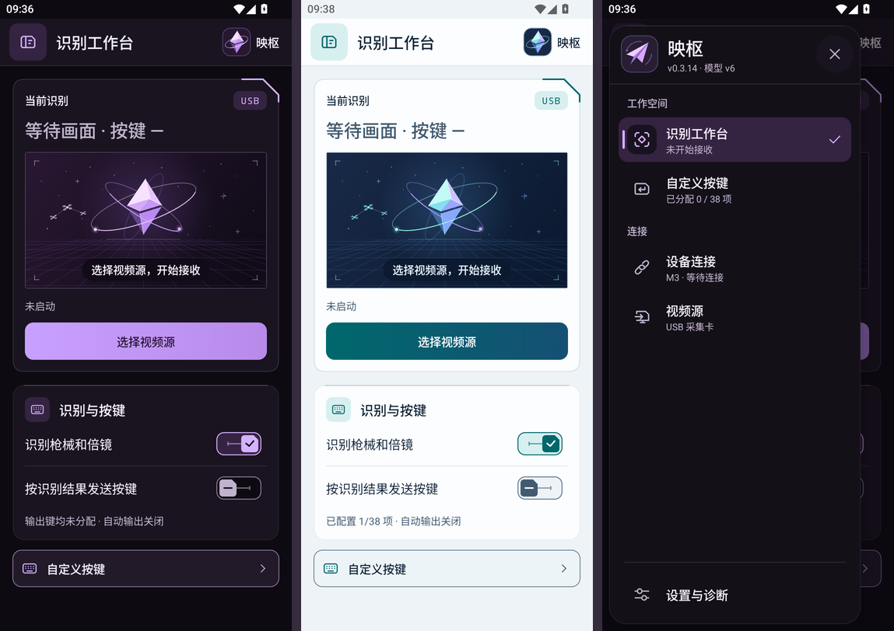

# 映枢 · Yingshu

Android 视频接收、游戏 HUD 枪械与倍镜识别，以及可自定义的 M3 按键映射工具。

当前源码版本为 **0.3.14-trial**（versionCode 18）。支持 Android 8.0 及以上、arm64-v8a。界面使用原生 Android Java；模型在手机本地通过 ONNX Runtime 推理。

[下载 0.3.14 安卓安装包（arm64）](https://github.com/Slave-LiLi/yingshu/releases/download/v0.3.14-trial/Yingshu-0.3.14-trial-arm64.apk) · [发布说明与校验文件](https://github.com/Slave-LiLi/yingshu/releases/tag/v0.3.14-trial) · [构建说明](docs/BUILD.md) · [模型与训练](docs/MODEL.md)

识别工作台的切角外框标出视频区域，普通设置卡片使用细边线。侧栏以短色条和勾号指示当前页，使用键盘时描边会跟随焦点。窄屏上下排列预览和控件，宽屏可并排操作。

## 功能

- 接收 USB 采集卡或局域网 NDI 视频，完整画面用于预览。
- 仅对右下角 HUD 区域应用遮罩并识别；单个共享模型同时输出枪械和倍镜。
- 视频预览上方显示“枪械＋倍镜 → 配置按键”。
- 为 37 个枪械与倍镜组合，以及“未识别到枪械”分别设置按键；支持搜索主按键和 Ctrl/Shift/Alt/Win 修饰键。
- 完整 38 项规则可复制为文本、保存/读取 TXT，并撤销最近一次导入。
- 左侧导航显示视频接收状态、按键分配进度、M3 连接状态和当前视频源类型。菜单可通过触控或键盘操作。
- 外观可跟随系统或手动切换。深色模式采用近黑底色、深紫面板和淡紫色操作按钮，支持拖动主题开关连续过渡。
- 首次启动显示开源许可与使用说明。首次进入按键设置时显示项目自定义的问题；问题、确认状态和设备信息不包含在按键导出文本中。

自动输出每次启动默认关闭。只有视频有效、识别结果稳定、M3 已连接且对应规则已分配时，才会提交按键。没有连接 M3 也可以预览和识别。

## 识别范围与限制

| 枪械 | 可配置倍镜状态 |
| --- | --- |
| VK、R301、复仇女神、转换者、L-STAR、猎兽、CAR | 无镜、1 倍、2 倍、3 倍、4 倍 |
| R99 | 无镜、1 倍 |

2–4 倍可调镜统一按 4 倍处理。规则可以配置，不代表每个组合都已有训练素材和独立验证。复仇女神仅有短暂的 2–4 倍镜素材；L-STAR 素材覆盖无镜/3 倍、猎兽和 CAR 覆盖 2 倍。v6 补充 R99 1 倍、转换者 1 倍、R301 2/3/4 倍素材，转换者保留原无镜素材。克雷贝尔未参与训练。

输入布局以 1920×1080 为基准，ROI 为 `(1472, 936, 320, 128)`。应用遮罩后上下各补 96 行，模型输入为 `320×320`。不同 HUD 比例、位置或外观需要重新验证；同一录像中的留出帧不代表独立新对局准确率。

## 0.3.13 实测与已知问题

0.3.13 更新为 v6 联合模型。以下数据来自该版的手机测试。荣耀 10 上约 **3.16 次识别/秒**。[手机实测说明](docs/evidence/0.3.13/phone-video-test.md) · [截图总览](docs/evidence/0.3.13/screenshots.md) · [下载 0.3.13 的 69 张完整截图](https://github.com/Slave-LiLi/yingshu/releases/tag/v0.3.13-trial)

指定旧录像的 62 个已支持枪械组合测试点中，39 次首次界面读数完整正确、22 次等待新画面、1 次未识别，即时正确显示覆盖率为 **62.9%**。另 7 个克雷贝尔测试点中出现 2 次误认复仇女神。结果显示过期空档与未知枪械误识别**尚未修复**，因此本版仍标记为试用版。以上包含 UI 状态，不是纯模型准确率；同源录像也不代表独立新对局泛化。[完整验证范围](docs/VALIDATION.md) 分别说明不同素材和测试方法。

## 源码与构建

- [构建说明](docs/BUILD.md)：依赖准备、自行签名、APK 构建和本地测试。
- [模型与训练](docs/MODEL.md)：可编辑权重、继续训练、导出和数据范围。
- [详细功能说明](README.txt)：规则、状态、视频接收与推理契约。
- [0.3.14 界面验证](docs/VALIDATION-0.3.14.md) · [0.3.13 模型与手机实测](docs/VALIDATION.md)
- [第三方组件说明](THIRD-PARTY.md)：模型、NDI 和 ONNX Runtime 的来源与许可。

仓库不包含发布者签名私钥、口令、手机偏好、原始日志或私人录屏。构建脚本不会安装、卸载手机应用，也不会自动生成或覆盖签名证书。

## 许可

项目自有代码按 [GNU AGPL 第 3 版](LICENSE) 提供；对自行编写的 NDI 集成提供 [有限链接附加许可](LICENSE-NDI-EXCEPTION.txt)。第三方组件和模型保留各自许可证，范围见 [第三方说明](THIRD-PARTY.md)。NDI 本身仍为专有组件。

官方发行免费，**允许符合适用许可证的收费分发**。修改或分发时仍须保留声明并按 AGPL 提供相应源码；本项目不附加“禁止二改收费”的限制。应用内的阅读记录和按键页问题不增加版权许可条件，也不限制修改这些界面流程的权利。中文说明见 [LICENSE-SOURCE.txt](LICENSE-SOURCE.txt)。

本项目不是游戏、M3 硬件、NDI 或 Ultralytics 的官方产品。
